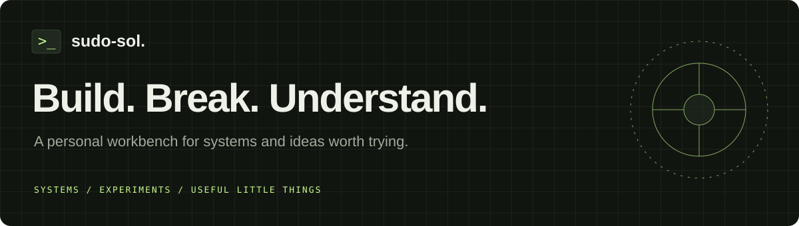

# sudo-sol

Addy's personal site: experience, projects, notes, and the person behind the terminal.

[Live site](https://sudo-sol.github.io/) · [GitHub profile](https://github.com/sudo-sol) · [LinkedIn](https://www.linkedin.com/in/asriniva/)

## What is here

- **Home:** a short intro, the experience "git log" card, and an interactive terminal.
- **Experience:** a git-graph timeline of roles, outcomes, and a toolbox, with a logo slot per company. Public-safe: outcomes only, with no incident or security specifics.
- **About:** a man-page-styled page (`man addy`) with the story, how I work, skills, interests, known bugs & features, and a contact form.
- **Workbench:** project cards (status, problem, approach, outcome, stack, links) with a status filter.
- **Notes:** the blog. A year-grouped archive with topic filters. Posts are written as markdown in `drafts/` and converted to pages (see [Write a note](#write-a-note)).
- **Labs (hidden for now):** `labs/` still exists, but every link to it is commented out. See [Bring labs back](#bring-labs-back).
- **Three themes:** dark, light, and cyber. The theme button cycles them, the choice is remembered, and `t` is the shortcut.
- **A terminal on every page.** Press `/` or the `>_` logo. See [The terminal](#the-terminal).
- Static HTML, CSS, and JavaScript. No framework, build step, external fonts, analytics, or API keys.

The traffic simulation runs entirely in the browser. Each online instance contributes **40 req/s** of capacity; served traffic is `min(incoming traffic, capacity)`. It illustrates a simplified capacity model, not a real service.

## Preview locally

From this repository, run:

```sh
python -m http.server 4173 --bind 127.0.0.1
```

Open **http://127.0.0.1:4173**. Stop the server with `Ctrl+C`.

Use the local server so root-relative assets and directory routes resolve correctly. Each route is a directory with its own `index.html`, so GitHub Pages serves `/experience/`, `/workbench/`, `/notes/`, `/notes/<slug>/`, and `/about/` (plus the hidden `/labs/`) without a router or build step. Preview that page at `/404.html`; Python's basic server does not automatically use it for missing routes.

## Publish later with GitHub Pages

The files are ready for branch-based Pages hosting. Nothing in this starter pushes, publishes, or runs a deployment automatically.

When you are ready:

1. Review the files, commit them, and push to this repository's `main` branch.
2. In the repository, open **Settings → Pages**.
3. Choose **Deploy from a branch**, then **main** and **/(root)**, and save.
4. Wait for GitHub's Pages deployment to finish. The expected address for this repository is **https://sudo-sol.github.io/**.

The empty `.nojekyll` file lets GitHub serve these static files without Jekyll processing. There is no custom domain configuration or deployment workflow to maintain.

Official references: [Create a GitHub Pages site](https://docs.github.com/en/pages/getting-started-with-github-pages/creating-a-github-pages-site) and [configure the publishing source](https://docs.github.com/en/pages/getting-started-with-github-pages/configuring-a-publishing-source-for-your-github-pages-site).

## Make it yours

| File | What it holds |
| --- | --- |
| `index.html` | Home: intro, experience card, inline terminal |
| `experience/index.html` | Timeline, stats, toolbox |
| `about/index.html` | About (man-page frame) and the contact form |
| `workbench/index.html` | Project cards |
| `labs/index.html`, `labs/traffic/index.html` | Lab gallery and the traffic simulation (hidden for now) |
| `notes/index.html` | Notes archive (the blog) |
| `notes/anatomy-of-a-note/index.html` | Sample post and the template for new ones |
| `drafts/_template.md` | Markdown template for new notes (see [Write a note](#write-a-note)) |
| `404.html` | Missing-page copy |
| `styles.css` | Theme tokens, layout, and page components |
| `app.js` | Keyboard shortcuts, home intro, résumé button, contact form, section highlighting, workbench/notes filters, read time, traffic lab |
| `assets/theme.js` | Dark → light → cyber theme switching (loaded in `<head>` to avoid a flash) |
| `assets/cyber.css` | The cyber theme skin (purely visual) |
| `assets/term.js`, `assets/term.css` | The site-wide terminal |
| `assets/` | Also the favicon and README banner |

### The terminal

`assets/term.js` is progressive enhancement over normal links. Remove its `<script>` tag and the site still works.

- A tmux-style bar is pinned to the bottom of every page. The panel opens above it, never blocks the page, and only hides with `/`, `Esc`, `exit`, or the toggle. On the homepage it lives inline at `[data-term-dock]`.
- **Pages come from the header nav.** `cd`, `ls`, and the tmux windows read `header nav a` (link text = name, `data-term-desc` = description). Add a page to the nav and the terminal knows about it.
- **Page items are opt-in markup.** Add `data-term-item="name"` (plus optional `data-term-desc`) to a section, `<details>`, or link. `ls` lists them and `open name` scrolls to them, opens them, or follows the link.
- **Suggested commands:** set `data-term-chips="ls, open x, cd ~"` on `<body>`.
- Output, history, and open/closed state persist per browser tab (sessionStorage). Output is built with `textContent`; input is never parsed as HTML.

### Keyboard shortcuts

`/` terminal · `?` shortcuts panel · `t` theme · `g` then `h`/`e`/`w`/`n`/`a` to jump to a page. Shortcuts are ignored while typing in a field.

### Résumé (not published yet)

The résumé buttons are intentionally inactive (`data-resume`, `aria-disabled="true"`) and show a "coming soon" note. To publish:

1. Add a public PDF **without phone number or home address** as `assets/resume.pdf`.
2. Replace each `<button … data-resume …>` with `<a class="btn primary" href="/assets/resume.pdf" download>`.
3. In `assets/term.js`, set `LINKS.resume.url` to `"/assets/resume.pdf"`.

### Contact form

The About page form posts to [Formspree](https://formspree.io/) once it is connected. Until then it tells visitors to use LinkedIn. To connect it:

1. Create a free Formspree form and copy its endpoint (`https://formspree.io/f/<id>`).
2. In `about/index.html`, set `data-endpoint="https://formspree.io/f/<id>"` on `#contact-form`.

The `_gotcha` field is a honeypot for bots. Submissions go to Formspree, a third party.

### Add a page

1. Create `<slug>/index.html` by copying an existing interior page (same `<head>` assets, header, and footer).
2. Add the link to the header `<nav>` **on every page**, with a `data-term-desc`.
3. Optionally tag things on the page with `data-term-item`.

### Add a project

Copy an `<article class="proj">` in `workbench/index.html`. Set `data-status` to `building`, `planned`, or `shipped` (it drives the badge and the filter), fill in problem, approach, outcome, and next, and give it a unique `id` and `data-term-item`. Keep entries ordered building → planned → shipped.

### Write a note

Write in markdown and ask Somi (your Copilot agent) to publish it:

1. Copy `drafts/_template.md` to `drafts/<slug>.md`. The file name becomes the URL (`/notes/<slug>/`).
2. Fill in the front matter (`title`, `emphasis`, `summary`, `date`, `tags`, `status`, `tldr`) and write the body. Every `## heading` becomes a section.
3. Ask: "publish drafts/<slug>.md". Put images in `drafts/<slug>/`.

`drafts/` is gitignored (except the template), so drafts never go public by accident. Only the generated page is committed.

**Conversion rules** (so every post looks the same):

- Build `notes/<slug>/index.html` from the structure of `notes/anatomy-of-a-note/index.html`: same `<head>` assets, header (with `aria-current="true"` on notes), and footer.
- Head: `<title>`, description and `og:description` = `summary`, `og:url` and canonical = `/notes/<slug>/`, `article:published_time` = `date`.
- Header: prompt `cat <slug>.md`, `<h1>` with the `emphasis` words in `<em>`, `.dek` = `summary`, `.post-meta` with the date, `data-read-time`, and `#tags`.
- Body: `tldr` → `.takeaway`. Each `##` → `<section id="<heading-slug>" data-term-item>` plus a matching link in `.toc`. Tables are wrapped in `.table-wrap`. Fenced code → `<pre><code>`, escaped. Images are copied to `notes/<slug>/` and wrapped in `<figure>` with `alt` text, `width`/`height`, `loading="lazy"`, a `<figcaption>`, and a link to the full-size file.
- Archive: add an `<li class="post-item">` to `notes/index.html` under its year (newest first) with `data-tags`, the summary, a read time, and `data-term-item` on the link. `status: draft` adds only a draft archive entry and no page.
- No `sample` tags on real posts. Keep it public-safe.

Drafts can also be listed by hand: give the `<li>` the `draft` class, use `<span class="when">draft</span>`, and leave the title unlinked.

### Sample content

Entries marked with a dashed **SAMPLE** tag (and an `<!-- SAMPLE -->` comment) are placeholders. Replace or delete them before publishing.

### Company logos

Each experience entry has a `.co-logo` tile with a monogram. To use a real logo, add it to `assets/logos/` and replace the monogram with `.svg" alt="">`.

### Bring labs back

Uncomment the `/labs/` link in the header nav of every page and in the About page's SEE ALSO, then restore `l: "/labs/"` and the `g l` row in `app.js`.

### Styling

Theme tokens are at the top of `styles.css`; cyber overrides live in `assets/cyber.css`. The theme preference is stored in `localStorage` under `sudo-sol-theme`. Reduced-motion preferences are respected.

## Structure

```text
.
├── index.html
├── experience/index.html
├── workbench/index.html
├── labs/index.html            (hidden)
├── labs/traffic/index.html    (hidden)
├── notes/index.html
├── notes/anatomy-of-a-note/index.html
├── drafts/_template.md         (drafts/ is gitignored)
├── about/index.html
├── 404.html
├── styles.css
├── app.js
├── assets/
│   ├── theme.js
│   ├── term.js
│   ├── term.css
│   ├── cyber.css
│   ├── favicon.svg
│   └── readme-banner.svg
├── .nojekyll
├── .editorconfig
├── .gitattributes
├── .gitignore
└── README.md
```

Small enough to understand. Open enough to grow.
