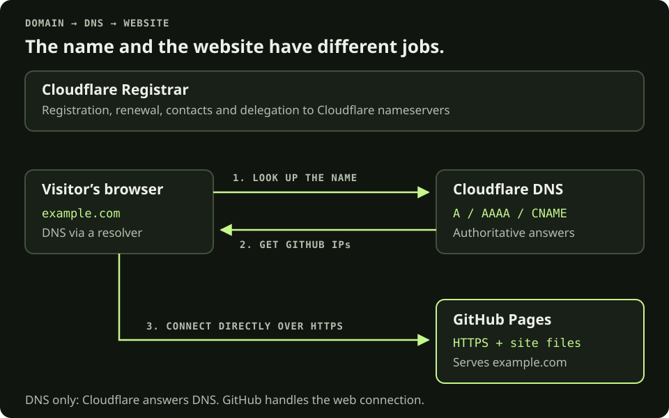
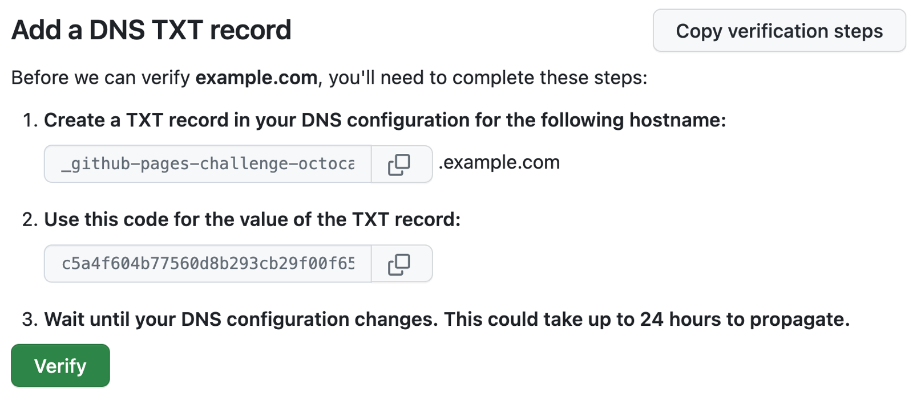
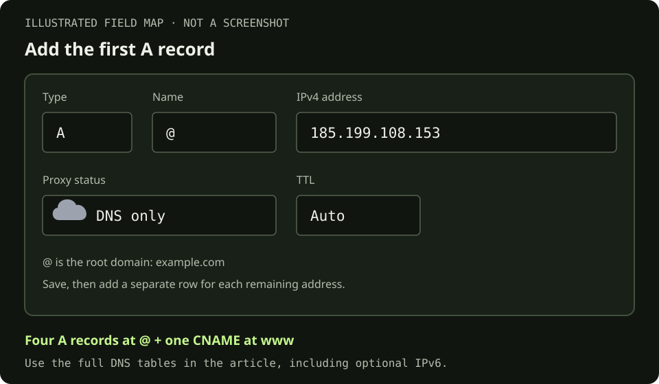

## The plan: one name, three jobs

Buying a domain reserves the name; it does not upload a website. The registrar manages the registration, DNS tells visitors where to go, and the host serves the files.

The examples below use `example.com` as the primary address and `www.example.com` as its alternate. Replace `example.com` with your domain and `USERNAME` with the GitHub account or organization that owns the site. For this repository, that account is `sudo-sol`, so the DNS target would be `sudo-sol.github.io`.

[](domain-flow.svg)

The lookup and the web request are separate. In this DNS-only setup, GitHub serves the website and its certificate. Click diagrams or screenshots for full size.

This walkthrough assumes a new domain and an existing static website. If the domain already serves a website or email, inventory its current records before changing anything.

## 1. Register the domain

1. Create or sign in to your Cloudflare account and verify the account email.
2. Open **Domain Registration → Register domains**. Search for the name you want and choose an available result.
3. Check the spelling, extension, registration term, total price, and renewal date before proceeding. Use the checkout price rather than a price from a tutorial.
4. Enter accurate registrant contact information and payment details. Review the agreements, then complete the purchase.
5. Confirm that the domain appears under **Manage domains** and save the confirmation email.

Domains registered here use Cloudflare nameservers; you cannot change to another DNS provider’s nameservers while Cloudflare remains the registrar. Hosting the website at GitHub is still possible. See [Cloudflare’s registration instructions](https://developers.cloudflare.com/registrar/get-started/register-domain/).

## 2. Do the housekeeping

- **Verify the registrant email.** This is separate from verifying the Cloudflare account email. Follow the registration verification message; an unverified registrant email can put the domain on hold. [Registration requirements](https://developers.cloudflare.com/registrar/get-started/register-domain/).
- **Check renewal.** Auto-renew starts enabled, but payment failures can still let a domain expire. Confirm the payment method, renewal date and notification inbox, and keep an independent reminder. [Renewal settings](https://developers.cloudflare.com/registrar/account-options/renew-domains/).
- **Protect the accounts.** Enable two-factor authentication for Cloudflare and GitHub, and store recovery codes somewhere you can reach if a device is lost.
- **Enable DNSSEC if it is not already active.** Under **Manage domains → Manage → Configuration**, enable DNSSEC. Cloudflare Registrar handles the registry side; allow one to two days and check the confirmed status in **DNS → Settings**. DNSSEC authenticates DNS answers; HTTPS encrypts the web connection. [Cloudflare’s DNSSEC guide](https://developers.cloudflare.com/registrar/get-started/enable-dnssec/).

Buying a domain does not create an email inbox. Leave mail setup for a separate step, and preserve any existing MX, SPF, DKIM and DMARC records.

## 3. Verify ownership in GitHub

For a personal site, open **GitHub profile → Settings → Pages → Add a domain**. Enter the apex domain, `example.com`. For an organization, use the organization’s Pages settings.

[](github-verify-dns.png)

Example screenshot from [GitHub Docs](https://docs.github.com/en/pages/configuring-a-custom-domain-for-your-github-pages-site/verifying-your-custom-domain-for-github-pages), © GitHub, Inc., [CC BY 4.0](https://creativecommons.org/licenses/by/4.0/), unchanged. These are documentation examples, not values to reuse. Dashboard wording can change.

Add GitHub’s generated record in **Cloudflare → your domain → DNS → Records → Add record**:

| Type | Name | Content | TTL |
| --- | --- | --- | --- |
| TXT | `_github-pages-challenge-USERNAME` | The exact code GitHub supplies | Auto |

Use the generated challenge label; Cloudflare appends the zone name. TXT records have no proxy toggle. Return to GitHub and select **Verify** once the record resolves. Keep the TXT record afterward. [GitHub’s verification guide](https://docs.github.com/en/pages/configuring-a-custom-domain-for-your-github-pages-site/verifying-your-custom-domain-for-github-pages).

## 4. Tell GitHub Pages about the domain

1. First make sure the website works at its existing `github.io` address.
2. In the website repository, open **Settings → Pages**. For a plain static site, the publishing source can be **Deploy from a branch**, with the intended branch and **/(root)**. Keep an existing working deployment workflow if you already have one. [Publishing-source options](https://docs.github.com/en/pages/getting-started-with-github-pages/configuring-a-publishing-source-for-your-github-pages-site).
3. Under **Custom domain**, enter `example.com` and save. Do this before adding the website DNS records. The initial DNS check may fail until the next step is complete. [Custom-domain setup](https://docs.github.com/en/pages/configuring-a-custom-domain-for-your-github-pages-site/managing-a-custom-domain-for-your-github-pages-site).

With branch publishing, GitHub adds a `CNAME` file to the publishing source. Keep that commit in your local checkout before subsequent pushes. Its entire content for this example is:

```text
example.com
```

The file uses uppercase `CNAME` and contains one hostname, without a scheme or path. A custom Actions deployment does not require this file; set the domain in Pages settings. [CNAME-file details](https://docs.github.com/en/pages/configuring-a-custom-domain-for-your-github-pages-site/troubleshooting-custom-domains-and-github-pages).

## 5. Add the Cloudflare DNS records

Open the domain’s **DNS → Records → Add record**. Create one record per row, with **TTL: Auto**. Here `@` means the apex, `example.com`. The `www` label means `www.example.com`. Save each entry. [Cloudflare’s record editor](https://developers.cloudflare.com/dns/manage-dns-records/how-to/create-dns-records/).

**Required for the apex + www setup in this guide:**

| Type | Name | Content / target | Proxy status |
| --- | --- | --- | --- |
| A | `@` | `185.199.108.153` | DNS only |
| A | `@` | `185.199.109.153` | DNS only |
| A | `@` | `185.199.110.153` | DNS only |
| A | `@` | `185.199.111.153` | DNS only |
| CNAME | `www` | `USERNAME.github.io` | DNS only |

**Optional IPv6:** add all four AAAA records alongside the A records.

| Type | Name | Content | Proxy status |
| --- | --- | --- | --- |
| AAAA | `@` | `2606:50c0:8000::153` | DNS only |
| AAAA | `@` | `2606:50c0:8001::153` | DNS only |
| AAAA | `@` | `2606:50c0:8002::153` | DNS only |
| AAAA | `@` | `2606:50c0:8003::153` | DNS only |

The addresses and CNAME target format come from [GitHub’s DNS reference](https://docs.github.com/en/pages/getting-started-with-github-pages/securing-your-github-pages-site-with-https#verifying-the-dns-configuration). Use the account hostname, such as `sudo-sol.github.io`, with no `https://` or repository path.

[](dns-record-editor.svg)

Illustrated field map, not a Cloudflare screenshot. The table above is the complete record list; this shows the first A record.

**Why the gray cloud?** DNS-only records return GitHub’s addresses and send web traffic directly there. Orange-cloud proxying returns Cloudflare addresses and puts Cloudflare in the web request path. This guide chooses DNS only to keep GitHub’s DNS checks and certificate setup straightforward; leave it that way for this configuration. Cloudflare’s SSL/TLS mode does not control the direct connection to GitHub. [Proxy behavior explained](https://developers.cloudflare.com/dns/proxy-status/).

Replace conflicting parking or old hosting records at `@` and `www`; do not combine them with the new records. Leave unrelated records intact. Avoid wildcard records such as `*`. [GitHub’s DNS guidance](https://docs.github.com/en/pages/configuring-a-custom-domain-for-your-github-pages-site/managing-a-custom-domain-for-your-github-pages-site).

## 6. Let HTTPS catch up

Return to **repository Settings → Pages**. Once the DNS check succeeds, GitHub requests the certificate. When available, enable **Enforce HTTPS**. Serve images, styles and scripts through HTTPS or relative URLs to avoid mixed content. [GitHub’s HTTPS guide](https://docs.github.com/en/pages/getting-started-with-github-pages/securing-your-github-pages-site-with-https).

DNS propagation and availability of the HTTPS checkbox can take up to 24 hours. With both apex and `www` configured, GitHub redirects the alternate to the hostname saved as the custom domain. This example chooses `example.com`, so `www.example.com` should redirect there. DNS resolves names; GitHub sends the HTTP redirect. [Propagation and redirects](https://docs.github.com/en/pages/configuring-a-custom-domain-for-your-github-pages-site/managing-a-custom-domain-for-your-github-pages-site).

## 7. Check each layer

Run these from a terminal with `dig` and `curl` installed, substituting your real domain and account:

```sh
# Ownership: expect the code GitHub generated
dig +short TXT _github-pages-challenge-USERNAME.example.com

# Apex: expect the four IPv4 addresses above (order may differ)
dig +short A example.com

# Only if IPv6 was configured: expect the four IPv6 addresses
dig +short AAAA example.com

# www: expect USERNAME.github.io.
dig +short CNAME www.example.com

# Inspect responses, certificate validation and redirects
curl -I https://example.com/
curl -IL https://www.example.com/
curl -IL http://example.com/
```

The primary HTTPS URL should serve the site; the alternate and HTTP URLs should end at the primary HTTPS URL. Do not use `curl -k`: a certificate error is something to fix, not skip. These commands are a checklist, not results from a live domain.

- Open both hostnames in a browser and confirm the final address and valid certificate.
- Check a nested page, images, styles, navigation and the 404 page.
- Update absolute canonical URLs, Open Graph URLs and any sitemap or feed to the chosen domain when you actually migrate the website.
- Keep the verification TXT record and the publishing source’s `CNAME` file where applicable.

## When something does not line up

| Symptom | Check first |
| --- | --- |
| No DNS answer | Domain status, registrant-email verification, spelling, record name and DNS propagation. |
| Cloudflare addresses in an A lookup | Confirm every website A, AAAA and CNAME record is DNS only. A proxied record at the same name can affect the others. |
| GitHub 404 | Pages deployment succeeded, the intended branch is published, and the custom hostname is saved in the correct repository. |
| Certificate still pending | Conflicting A/AAAA/CNAME records, proxy status, and existing CAA restrictions. If CAA is configured, it must permit `letsencrypt.org`. |
| Only www fails | Its CNAME points to the account’s `github.io` hostname, without a path, and its certificate is ready. |

See [GitHub’s troubleshooting guide](https://docs.github.com/en/pages/configuring-a-custom-domain-for-your-github-pages-site/troubleshooting-custom-domains-and-github-pages) and [Cloudflare’s proxy-status rules](https://developers.cloudflare.com/dns/proxy-status/). Fix the record set before repeatedly removing and re-adding the domain. If you later retire the site, remove its website DNS records when you disconnect Pages, and keep ownership verification.

Reference checked October 27, 2026 against the linked official documentation. This is a setup guide; it does not record a domain purchase or a live migration.
