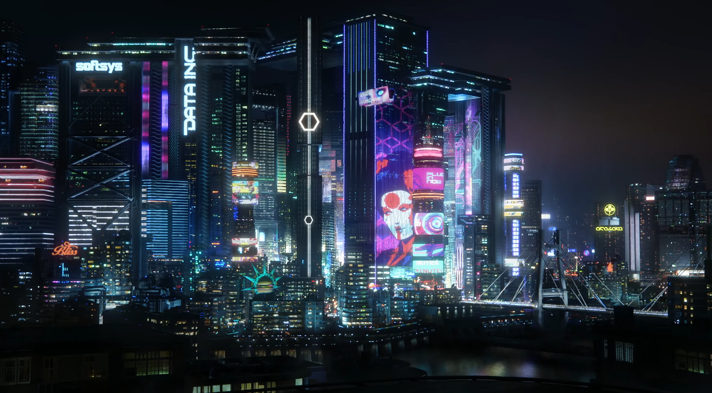
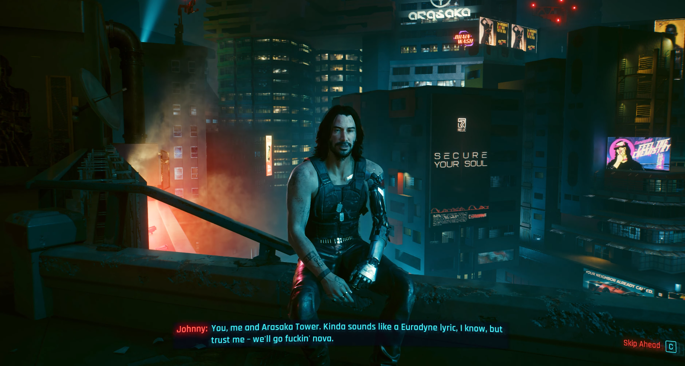

## Kindness in Night City

Night City does not reward kindness. I knew that going in. I played like a good-hearted person anyway.

Then the game did what it always does: it took my kindness, used it, and handed me the bill. By the end I wasn't just controlling V. I was V, and some of those choices followed me out of the room.

## Why Corpo V got me

I tried a few life paths, but Corpo V is the one that clicked. I played V as the guy who helps everyone and gets used by everyone. Sound familiar? It felt a bit too close to real life, which is exactly why it hit so hard.

I never played V from the outside. I stood in V's shoes the whole time. No single gig wrecked me. The whole game did, slowly.

## Evelyn: the one who got to me

If one character still has a piece of my heart, it's Evelyn. After what she went through at Clouds and later at the abandoned power plant, I could never see her as a villain. She's a victim. She flew too close to the sun and got burned by it.

Could she have avoided it? Maybe. She really should have done a background check on the Voodoo Boys, especially with her job built around connecting with people and knowing the gangs of Night city. But here's the part that stings: it was never going to end well. Even if the heist had gone perfectly, the Voodoo Boys were in the picture, and in Night City that's a bad sign. The ending was rigged before she even made a choice.

## Songbird: the long game of playing dumb

Phantom Liberty is where my choices got sneaky.

I believed Songbird about the cure. She's powerful, she overrode Johnny the moment they met, and I wanted to trust her. As the story rolled on, the lies got harder to ignore. But I was too deep in, and betraying her just to watch her suffer felt wrong. There was a practical reason too. I read on Reddit that taking the NUSA cure means losing the ability to use cyberware, so handing her back would have been for nothing for V and at the same time, So mi suffers at the hands of Rosalind being a caged bird again.

So I kept smiling, kept playing dumb, and let her fly to the moon with the cure.

Here's what got me. NUSA used her, and they were still using her while she was dying. I wanted her to be free, because I know what feeling trapped is like. That wasn't the least bad option. At that point it was the right one.

## Sol: when there is no good answer

Killing Sol still sits in my chest. He was a good person but working for the NUSA, he is basically brainwashed too deep in, sitting in Rosalind Myers' pocket. The deal was simple and brutal: either I die and he takes Songbird alive, or I kill him.

When you can't save everyone, you protect the person who can still be saved. And hey, at least Alex made it out.

## Arasaka Tower: one giant middle finger

My finale was a one man army run to Mikoshi with Johnny. Two reasons.

- It was the one option where nobody I love had to die for me.
- It let out every bit of frustration from losing everyone I loved and being used by the city, all game long.

It wasn't the "wise" move. It was the human one. And it felt incredible.

## Proof that good people exist

Night City isn't all rot. Mama Welles was like a mom to V. Vic and Misty are saints compared to the rest of the city. They're the reason I believe there's still good in this world, even if it's rare and gets stepped on a lot.

## The credits that froze me

The moment that really broke me came after the ending. The calls roll in, the song plays, and I just sat there. I didn't move until the TV went black.

That's when it hit me that this game is a masterpiece. I have never felt that deep playing anything else.

## So, what's the morality of Night City?

Not good versus evil. Not clean choices. It's about who you protect when every option costs you something, and whether you stay kind when the world punishes you for it.

I chose kindness. I got burned. And I'd do it again.

## When the screen goes blank and reality is here

The TV went black, and there I was on the couch. No Johnny in my head, no Arasaka Tower, just a quiet room and real life waiting. Weirdly, the quiet felt a lot like the credits.

### What I learned

Kindness isn't the problem. Kindness with no filter is. Evelyn needed a background check on the Voodoo Boys. I needed my own version of it: be good to people, but look at who you're being good to. With Songbird I saw the lies and chose to help her anyway. That's the difference between being naive and being kind with your eyes open.

### Night City vs. real life

Night City gives you a dialogue wheel, a save file, and a big glowing marker telling you where the story is. Real life has none of that. There's no quicksave before a hard talk, and the consequences show up slowly and quietly, not in a cutscene.

But real life has a few perks too. I don't work for an evil megacorp. Nobody is trying to put a chip in my head. And there are way more Mama Welleses, Vics and Mistys around than Night City would have you believe.

### Borrowed wisdom

Plenty of stories have been here before me:

- **Cyberpunk: Edgerunners.** David burned out chasing a dream, and Lucy's dream was the moon. Letting Songbird go there felt like finishing Lucy's story the way it should have gone.
- **The Last of Us.** Joel picks one person over the whole world. My Songbird choice was a tiny version of that: protect the one person you can still protect.
- **Red Dead Redemption 2.** Arthur Morgan spends his last stretch trying to do right by people who can still get out. That's my Sol logic exactly.
- **Spider-Man (Peter Parker).** Probably the closest thing to V in a mask. He gets berated by JJJ, loses people he loves, and still picks kindness every single time. In No Way Home he even tries to save the villains who came after him. That’s my Songbird choice in a nutshell: help someone who lied to you because you know what being cornered feels like. Peter also reminds me that being soft doesn’t mean being weak. Real strength is staying kind when the world gives you every reason not to.

### What I'm taking with me

I want to stay kind, but not a pushover. Help people, say no more often, and don't treat "being taken advantage of" as the price of being nice. That tower run wasn't just a game moment. It was a reminder that I'm allowed to push back...
