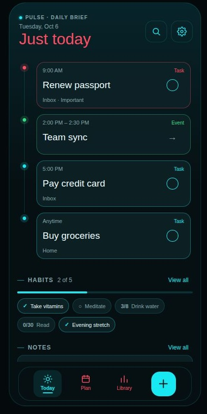
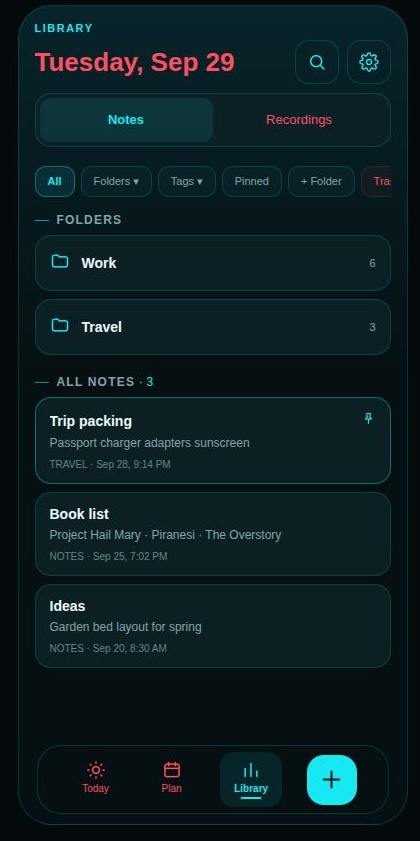

## Too many places to look

I built Pulse because I was tired of needing a separate app for everything.

Tasks in one place. Appointments in another. Habits somewhere else. Notes and recordings in their own little corners. Each tool could do its job, but keeping track of my day still meant moving between them.

What I wanted was fairly ordinary: one place to return to throughout the day. Somewhere to see what needs doing, keep the information around it, and get on with things.

Pulse is my attempt at that. It's a private Android app I built for myself, and now use day to day.

## Start with today

The screen I keep coming back to is called Today. Its heading is **Just today**, which captures the intention quite well.

It brings due tasks and calendar events into one timeline, with scheduled habits underneath. Notes can appear there too, but only when I explicitly choose to surface them. A note being recently edited doesn't automatically make it something I need to see today.

I like that boundary. A place to plan can hold quite a lot; the place I open to look at my day needs to be more selective.

*The Today design reference uses fictional sample data. This is a browser preview of the layout, rather than a screenshot from my phone.*

The details still belong in their own areas. I can open a task to work on it, go into Calendar to look ahead, or visit Habits for its history. Today brings those pieces together without trying to become every screen at once.

## A place for the things around the plan

The other half of Pulse is keeping information close enough to be useful.

Library holds Notes and Recordings. Notes have folders, tags, formatting, and attachments. Underneath the editor, the text is Markdown-compatible, with a portable Markdown export. That matters to me: writing something down shouldn't make it dependent on this one app forever.

Tasks and calendar events can link to notes. It is a small connection, but a useful one. An appointment and the note I need for it can stay separate while still being easy to find together.

*The Notes design reference also uses fictional content. The images illustrate the intended experience; they don't establish native Android behavior or completed device testing.*

## Built for my phone, with my data

Pulse is written in Kotlin with Jetpack Compose, with Room and SQLite underneath and encryption for local data. I install it directly as an APK. There is no account to create, and ordinary use works offline.

Building for one person gives me room to make very specific choices. I can shape the app around how I organize things, then change the parts that turn out to be awkward in daily use.

It also makes reliability personal. These are my tasks and notes. An upgrade needs to preserve them. A backup needs a credible recovery path. Getting a screen to render is only one part of making something I can trust with everyday information.

The project has backup and recovery work in place, alongside an explicit list of remaining device and resilience checks. I want to keep that distinction visible: implemented, installed, and fully verified are different claims.

## Useful before it gets clever

Eventually, I want a private assistant that can connect context across Pulse and the other apps I'm building. That is still a future direction. AI, cloud sync, and online transcription are deferred in Pulse.

The app needs to be useful on its own first. I should be able to open it, find my next task, write a note, or check my calendar without a model or a network connection being involved.

For now, the most satisfying outcome is also the simplest: I built an app I actually use. There are still rough edges and unfinished checks, but I have one place for more of my day, and a project I can keep shaping as I learn what I need.

## What's next

Pulse is useful in my daily life, but there is still work to do. I want to fill the remaining feature gaps, fix the minor bugs, and test it on more devices. Eventually, I'd like to make it open source so others can use it too.

For now, I'll keep using it, learning from the rough edges, and improving it one step at a time.
